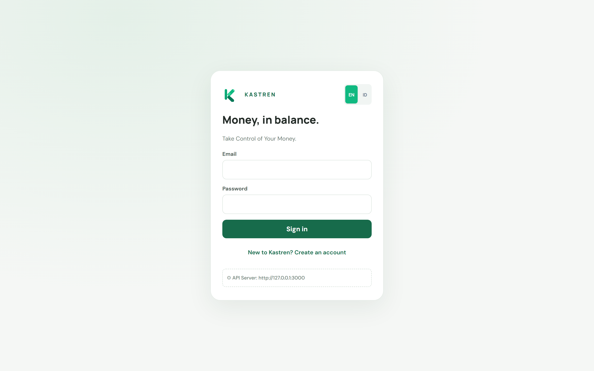
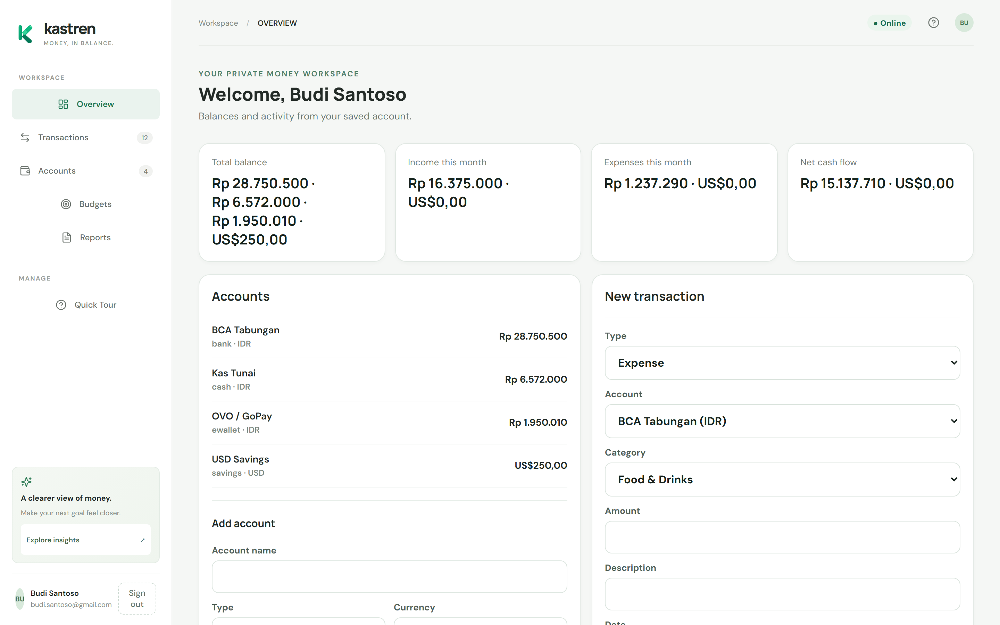
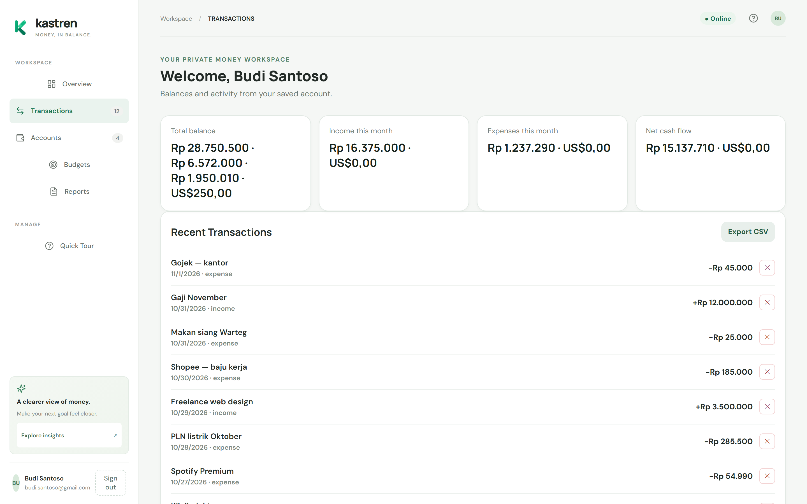
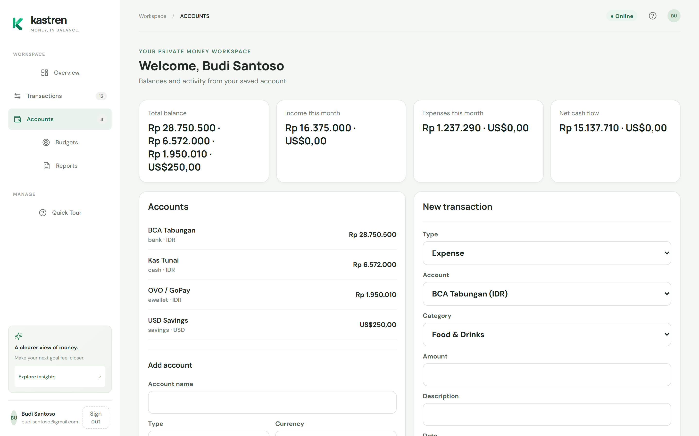
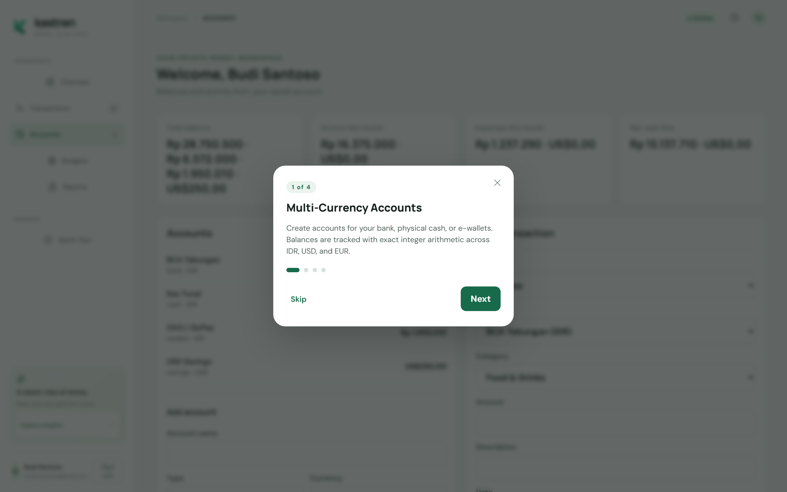

# Kastren — Smart Money Management

**Take Control of Your Money.** Web-first personal finance app with a Fastify REST API, PostgreSQL backend, React SPA, and Capacitor mobile shell. Tracks multi-currency accounts, income/expense transactions, savings goals, debts, recurring schedules, and monthly cash-flow summaries — all scoped to the authenticated user's private workspace with CSRF-protected sessions and Argon2id password hashing.

## Screenshots

### 1. Authentication Screen

The entry point to Kastren's private workspace — a clean sign-in and registration form with bilingual support (English / Bahasa Indonesia). The form validates email format and enforces a minimum 12-character password on registration. An API server configuration panel is available for mobile emulator testing against custom host addresses.



### 2. Overview Dashboard

The main dashboard greets the authenticated user with four live metric cards: total balance per currency, income this month, expenses this month, and net cash flow — all computed with exact integer arithmetic, zero rounding. Below the metrics, the Accounts panel lists each account with its real-time balance, alongside a quick-entry New Transaction form pre-populated with the user's own categories and accounts.



### 3. Recent Transactions

The Transactions view lists every recorded entry chronologically with description, date, type badge, signed amount (−/+), and a per-row delete control. A one-click **Export CSV** button downloads the full transaction history. The panel stays in sync — optimistic offline mutations queued in the local outbox are flushed automatically on reconnect and reflected here immediately.



### 4. Accounts & Quick Entry

The Accounts tab surfaces every account with its current live balance computed from opening balance plus all settled transactions. Below the list, the **Add Account** form accepts a name, type (bank, cash, e-wallet, savings, credit, other), and currency (IDR / USD / EUR). The adjacent **New Transaction** panel lets users record income or expenses against any account and category without leaving the page.



### 5. Quick Tour Onboarding

A four-step guided tour walks new users through Kastren's core features: multi-currency account setup, real-time transaction recording, monthly cash-flow monitoring, and the privacy model. The modal is triggered on first sign-in or manually from the sidebar, with step navigation, progress dots, and a skip option.



---

## Requirements

- Node.js `>=24`, npm.
- PostgreSQL 16+ for API runtime.
- Docker Desktop only if using included local PostgreSQL Compose setup.

## Start the app locally

Install dependencies once. Configure `.env` as described below. This workspace has local-only values; they are ignored by Git and must not be copied into reports.

```sh
npm install
```

Terminal 1 — database and API:

```sh
npm run db:up
npx prisma migrate deploy
npm run db:generate
npm run dev:api
```

Terminal 2 — web client:

```sh
npm run dev -- --host 127.0.0.1 --port 5175 --strictPort
```

Open `http://127.0.0.1:5175`. `WEB_ORIGIN` in `.env` must match the exact frontend origin. The first run requires account registration; use only local development data.

## Configure the local database (first setup only)

If no `.env` exists:

```sh
cp .env.example .env
```

Replace `POSTGRES_PASSWORD` with a unique local secret, put the same value in `DATABASE_URL` in URL-encoded form. Replace `SESSION_SECRET` with at least 32 random characters. Keep `.env` private; it is ignored by Git.

Local DB binds to `127.0.0.1:5433` to avoid the common `5432` conflict. Set `WEB_ORIGIN=http://127.0.0.1:5175` for the command above and `VITE_API_URL=http://127.0.0.1:3000` for the web client.

## Production API setup

For deployment, set `WEB_ORIGIN` to the exact HTTPS frontend origin and `NODE_ENV=production`; secure cookies are enforced. Interactive API docs are at `/docs` from localhost; JSON/YAML specs at `/documentation/json` and `/documentation/yaml`. Password-reset completion returns HTTP 501: no email provider is configured.

## API notes

The API listens on `127.0.0.1:3000`; docs are available at `/docs` from localhost, JSON/YAML specs at `/documentation/json` and `/documentation/yaml`. Password-reset completion returns HTTP 501; no email provider is configured. Set production `WEB_ORIGIN` to the exact HTTPS frontend origin and `NODE_ENV=production`; secure cookies are enforced.

## Implemented API routes

- `GET /health`, `GET /documentation/json`, `GET /documentation/yaml`
- `GET /auth/csrf`, `POST /auth/register`, `POST /auth/login`, `GET /auth/me`, `POST /auth/logout`, `DELETE /auth/account`
- `POST /auth/password-reset/request` (enumeration-safe acknowledgment only), `POST /auth/password-reset/complete` (501; no mail delivery)
- `GET|POST /accounts`; `PUT /accounts/:id`; `POST /accounts/:id/archive`; `GET /accounts/:id/transactions`
- `GET|POST /categories`; `GET|PUT /categories/:id`; `POST /categories/:id/archive`
- `GET|POST /transactions`; `GET|PUT|DELETE /transactions/:id`; `POST /transactions/bulk-delete`; CSV export
- `GET|POST /budgets`
- `GET|POST /goals`; `POST /goals/:id/contributions`
- `GET|POST /debts`; `POST /debts/:id/payments`
- `GET|POST /recurring`; `POST /recurring/:id/toggle` (schedule templates only; no automatic posting)
- `GET /reports/cashflow`, `/reports/monthly`; CSV report export
- `GET /dashboard/summary` (API; UI is not connected yet)

Authenticated state-changing calls require the `kastren_csrf` cookie token in `x-csrf-token` plus an exact allowed `Origin`. Cookie session IDs are opaque, random, stored only as SHA-256 hashes in DB; session cookie is HttpOnly, SameSite=Strict. Password hashes use Argon2id. Password changes and account archival exist in the API. Password reset has no delivery integration; recurring schedules are templates only; there is no automated scheduler or offline sync. Account deletion cascades all user records; use only with informed awareness. API endpoint behavior has not been exercised against a live PostgreSQL database in this environment.

## Data rules / schema

Prisma schema/migration at `services/api/prisma/`. Uses PostgreSQL UUIDs, foreign keys tying accounts/categories to their owner, integer `BIGINT` minor-unit amounts. Opening balances excluded from income. Transfers modify both account balances, never income/expense cash flow; no cross-currency transfer/aggregation. Direct transaction edits/deletes currently change/delete rows; immutable audit ledger not yet present. API summary currently replays all transactions (unbounded history query) and therefore needs indexed aggregation/materialized snapshots before scale.

## Checks

```sh
npm run typecheck
npm test
npm run build
npm run test:api
npm audit --omit=dev --audit-level=high
```

Verified in the local development environment: TypeScript typecheck, Vite production build, Vitest suite (17/17 tests passed: financial-engine math, Fastify security boundary, mobile Capacitor CORS/CSRF handling, live PostgreSQL integration, transaction deletion with balance recalculation, CSV export, cross-user data isolation, full password-reset lifecycle, offline queue dropout and poison resilience), Prisma migrations (including `PasswordResetToken`), responsive mobile/desktop UI with safe-area support, Quick Tour onboarding flow, offline transaction outbox queue with optimistic caching, and CSRF-protected authentication flow on running Web/API instances (Vite port 5175, API port 3000, PostgreSQL port 5433). Android SDK (API 35, build-tools 35.0.0, platform-tools) and OpenJDK 21 configured. Native Android debug APK compilation (`gradlew.bat --no-daemon assembleDebug`) verified with output artifact at `android/app/build/outputs/apk/debug/app-debug.apk` (4.2 MB, package `com.kastren.app`). Native iOS Capacitor project generated (`ios/App/App.xcworkspace`) with ATS configuration and automated macOS Xcode compilation workflow (`.github/workflows/ios-build.yml`). Production readiness has not been assessed.

## Platform status

- **Web:** Verified locally. Running UI (127.0.0.1:5175) and API (127.0.0.1:3000) verified with live CSRF, registration flow, Quick Tour onboarding, offline local outbox queue, and responsive layout across desktop and mobile screen viewports.
- **Android:** Verified local debug APK build (`android/app/build/outputs/apk/debug/app-debug.apk`, 4.1 MB) using Capacitor 7 + Gradle 8.11.1 + OpenJDK 21. Configured with `android:usesCleartextTraffic="true"`, custom/preset API host configuration (for emulator `10.0.2.2:3000` or device LAN IP), and Capacitor CORS/CSRF origin support. Production release keystore signing not configured.
- **iOS:** Capacitor iOS project generated (`ios/App/App.xcworkspace`) with NSAppTransportSecurity cleartext support and `.github/workflows/ios-build.yml` for macOS runner builds. Local testing on this host is limited by lack of physical macOS/Xcode.
- **Desktop:** Deferred; Tauri shell unverified (Rust/Cargo unavailable).
- **Offline sync:** Implemented. Local outbox queue with optimistic transaction updates, localStorage cache, network state detection, and automatic background synchronization on reconnect.

## Explicit limitations

- **Production hosting:** Local stack only; live cloud deployment, DNS, and TLS certificates have not been provisioned on a public server. Hardened configuration templates and deployment manifests are available in `deploy/` and `docs/DEPLOYMENT.md`.
- **Database backups & PITR:** Local snapshotting script with `pg_restore` verification, automated pruning, continuous WAL recovery architecture, and optional offsite S3/rclone cloud storage sync hooks authored in `scripts/db-backup-pitr.sh` and `docs/DATABASE_RECOVERY.md`.
- **Password reset delivery:** Backend endpoints, token hashing lifecycle, and pluggable mail adapter (supporting Resend API and standard SMTP via Nodemailer) are wired into `services/api/src/server.ts` and verified. Live production email delivery requires setting `RESEND_API_KEY` or `SMTP_HOST` in `.env.production`.
- **Desktop (Tauri):** Build unverified; deferred per request in favor of mobile focus.
- **Release keystore / code signing:** Android debug APK is compiled and verified, but production release keystore signing and Apple Developer provisioning profiles are not configured.

## Security notes

`docs/SECURITY.md` lists release gates. HTTPS and strong secrets are mandatory for production. Docs UI is limited to loopback addresses. No live bank integration, paid API, production hosting, backup, email delivery, or third-party account sync is configured.
